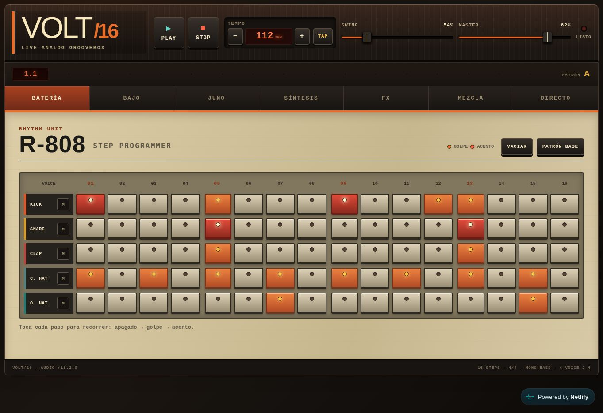
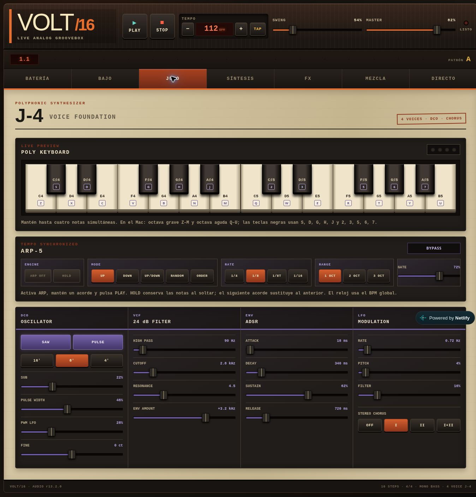

# Hola, soy Sergio Devece · SerxDev 👋

### Productor musical · Estudiante de DAM · Creador de herramientas de audio

Más de 30 años de experiencia en música, producción, mezcla y mastering, ahora también aplicados al desarrollo de software.

Construyo **instrumentos web, plugins de audio y un DAW nativo** dentro de **Vitalab / VitaPlug**, mientras estudio **Desarrollo de Aplicaciones Multiplataforma en DIGITECH**.

**Criterio musical, desarrollo asistido por IA y aprendizaje desde la práctica.**

[**Portfolio · serxdev.org**](https://serxdev.org) · [Probar VOLT/16](https://volt-16-live-drum-machine-synth-bass.netlify.app/) · [Explorar VitaDAW](https://github.com/sergiodevece/VITADAW) · [Conocer HARMOHIT MASTER](https://github.com/sergiodevece/VitaPlug-HARMOHIT-MASTER)

📍 Valencia, España

---

## 🎛️ VitaDAW · Proyecto de largo recorrido

**[Estación de trabajo de audio nativa en C++20 y JUCE](https://github.com/sergiodevece/VITADAW)**, nacida de necesidades reales de producción musical.

Incluye reproducción de varias pistas, grabación mono/estéreo sobre una pista armada, monitorización de entrada, edición no destructiva con formas de onda y Undo/Redo, transporte musical y routing con buses y envíos.

El núcleo portable se prueba sin hardware; la integración con dispositivos se contrasta también mediante pruebas físicas. El trabajo actual se centra en la **fiabilidad de la grabación y el ciclo de vida del dispositivo de audio**.

**Estado:** en desarrollo, sin versión estable para usuarios. El alojamiento de plugins externos y el MIDI avanzado forman parte de la visión futura. El README del proyecto recoge las capacidades, validaciones y limitaciones actuales.

`C++20` · `JUCE` · `CMake` · `CTest` · `Audio en tiempo real`

## 🥁 VOLT/16 · Groovebox en el navegador

**Batería de inspiración 808, bajo monofónico y sintetizador J-4 de cuatro voces**, con secuenciadores de 16 pasos, arpegiador ARP-5, mezcla, efectos por canal y controles para directo. El sonido se genera con Web Audio API.

[**Abrir la demo**](https://volt-16-live-drum-machine-synth-bass.netlify.app/) · [Código y documentación](https://github.com/sergiodevece/VOLT-16)

*Captura de la demo web · 28 de octubre de 2026.*

Ver el sintetizador J-4 y el arpegiador ARP-5

*Captura de la demo web · 28 de octubre de 2026.*

**Estado:** demo funcional en evolución, orientada principalmente a escritorio; compatibilidad y rendimiento sujetos al navegador y al dispositivo.

`JavaScript` · `Web Audio API` · `HTML` · `CSS` · `PWA`

## 🔊 VitaPlug · Procesadores para mezcla y mastering

Herramientas de audio desarrolladas con **C++ y JUCE**, guiadas por la escucha en estudio y contrastadas con pruebas técnicas.

| Proyecto | Enfoque | Estado documentado |
| --- | --- | --- |
| [**HARMOHIT MASTER**](https://github.com/sergiodevece/VitaPlug-HARMOHIT-MASTER) | Modelado espectral, excitación y DRIVE 670 con compresión y coloración; procesamiento estéreo y Mid/Side. | Versión de desarrollo, probada como AU en Logic sobre Apple Silicon. |
| [**HARMOHIT MIX**](https://github.com/sergiodevece/VitaPlug-HARMOHIT) | Modelado espectral, excitación aural y drive para pistas y buses. | Proyecto en desarrollo; el repositorio distingue el editor implementado y las referencias visuales. |
| [**Gainer80**](https://github.com/sergiodevece/vitaplug-gainer80) | Ganancia, realce de graves a 80/160 Hz y medidores VU de entrada y salida. | Base de desarrollo v0.1.0, con validación AU en Logic y comprobaciones adicionales pendientes por plataforma y formato. |

*HARMOHIT MASTER v0.2.0 · Render del componente editor real, publicado en el repositorio; no es una captura dentro de Logic.*

Los requisitos, formatos, condiciones de uso y límites de compatibilidad se detallan en cada repositorio.

## 🧪 Más herramientas y aprendizaje

| Proyecto | Qué aporta | Enlaces |
| --- | --- | --- |
| **VLA-73 Mastering Analyzer** | Análisis orientativo de mezcla y mastering en navegador, medidores e informe PDF. | [Código](https://github.com/sergiodevece/vla73-vitalab-audio-mastering-analizer) · [Demo v3](https://vla-73-mastering-vitalab-audio-v3.netlify.app/) |
| **Studio Boss** | Seguimiento gamificado de sesiones creativas, progreso y descansos, con persistencia local. | [Código](https://github.com/sergiodevece/studio-boss) · [Demo](https://vitalab-gestor-habitos-compositor.netlify.app/) |
| **Vitalab Learning Lab / Audio Meter Studio** | Laboratorio de aprendizaje que incluye un medidor de entrada de audio con vistas de onda y espectro. | [Código y aprendizajes](https://github.com/sergiodevece/vitalab-learning-lab) |

## 🧰 Habilidades y tecnologías

| Área | Experiencia y herramientas |
| --- | --- |
| **Experiencia musical** | Producción, composición, bajo, mezcla, mastering y evaluación mediante escucha crítica. |
| **Utilizadas en los proyectos de audio** | C++17/20, JUCE, CMake, CTest y DSP. |
| **Utilizadas en los proyectos web** | JavaScript, HTML, CSS, Web Audio API, Canvas y localStorage. |
| **Desarrollo y publicación** | Git, GitHub, GitHub Actions y Netlify. |
| **En formación** | Python, Java, SQL, XML, bases de datos y fundamentos de arquitectura y testing. |

Las tecnologías utilizadas describen el trabajo de los proyectos; mi formación como programador sigue en curso.

## 🧭 Cómo trabajo con IA

Dirijo el producto desde la experiencia musical: defino necesidades, prioridades y criterios de aceptación, reviso resultados y realizo las pruebas de escucha y de uso con dispositivos reales.

Utilizo **ChatGPT, Claude Code y Codex** para planificar, investigar, implementar, depurar y revisar, según lo que requiera cada tarea. El proceso combina cambios acotados, control de versiones, pruebas automatizadas y documentación de las decisiones y los límites conocidos.

Mi objetivo es **entender cada vez mejor lo que construyo** y convertir cada proyecto en aprendizaje técnico que pueda aplicar al siguiente.

---

**Tecnología creada desde la experiencia humana real.** 
Construir · Escuchar · Comprobar · Aprender

